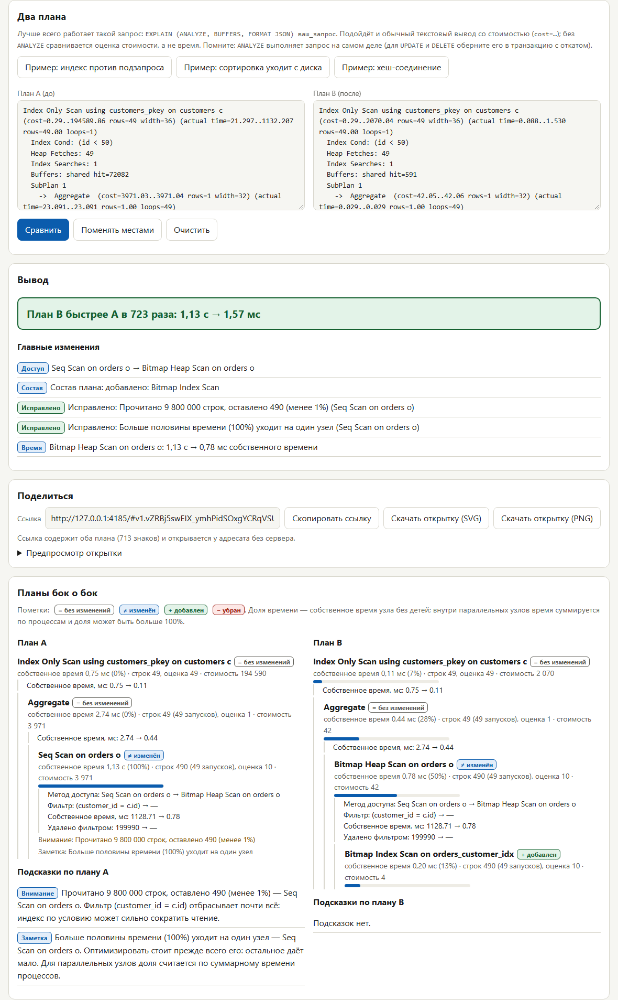

# plan-postcard

[](https://github.com/Oleg4311/plan-postcard/actions/workflows/ci.yml)
[Открыть](https://oleg4311.github.io/plan-postcard/) · [Релизы](https://github.com/Oleg4311/plan-postcard/releases)

**Сравнение двух планов `EXPLAIN` PostgreSQL.** Вставьте план «до» и «после» (JSON или обычный текст, с `ANALYZE` или без), и страница скажет: во сколько раз изменилось время, **что именно поменялось** (метод доступа, вид соединения, порядок таблиц, добавленные и убранные узлы), **где ушло время** (собственное время каждого узла), **где оптимизатор ошибся** в оценке строк и что из найденных проблем исправлено или появилось. Результат можно отправить коллеге **открыткой** (SVG или PNG для чата) или **ссылкой**, в которой зашиты оба плана. Всё считается в вашем браузере, планы никуда не уходят.



*English: paste two PostgreSQL EXPLAIN plans (JSON or text, with or without ANALYZE) and get what changed, where the time went, where the planner misestimated, and what was fixed or introduced — in the browser, shareable as a postcard image or a self-contained link. See the [English section](#english).*

## Зачем

Планы запросов читать тяжело, а сравнивать два тяжелее вдвое: узлы переставляются, появляются `Sort` и `Hash`, `Seq Scan` превращается в `Bitmap Heap Scan`, а время родителя включает детей. Здесь узлы двух планов сопоставляются автоматически, время раскладывается по узлам, а типичные проблемы подсвечиваются с объяснением и числами из самого плана.

## Что умеет

| Возможность | Как |
|---|---|
| Форматы | JSON (`FORMAT JSON`, в том числе из psql и pgAdmin: с заголовком, в кавычках) и текст (в том числе с рамкой psql, CRLF, старый формат PostgreSQL 9–12); автоопределение |
| Сопоставление узлов | по обращениям к таблицам (имя и псевдоним), затем по общим таблицам под внутренними узлами, затем по форме: переживает смену метода доступа, порядка соединений и вставку `Sort`/`Hash` |
| Время | собственное время узла (без детей) и доля; для параллельных планов считается суммарное время процессов, и это сказано в тексте |
| Ошибки оценки | во сколько раз оптимизатор ошибся в числе строк, с учётом того, что под `Limit` и `Merge Join` чтение обрывается намеренно |
| Подсказки | ошибка оценки, отсев почти всех строк при `Seq Scan`, сортировка на диске, хеш в нескольких пакетах, запущено меньше рабочих процессов, `Index Only Scan` с обращениями к куче, подзапрос выполняется тысячи раз, вложенный цикл с огромным числом запусков, узел при отключённом `enable_*`, временные файлы, холодный кэш, один узел съедает больше половины времени |
| Итог сравнения | заголовок с ускорением, список главных изменений, «исправлено» и «появилось» по сопоставленным узлам |
| Без `ANALYZE` | сравнивается оценка стоимости, и страница об этом говорит прямо |
| Открытка и ссылка | SVG 1200×630 и PNG; ссылка с обоими планами в хеше адреса (deflate, до 8000 знаков), защита от «бомбы» сжатия |

## Как это сделано и чем проверено

```
текст/JSON ──parse──▶ PlanNode (один вид для обоих форматов) ──diff──▶ пары / добавлено / убрано
                                  │                                       │
                                  └── метрики, подсказки ─────────────────┴──▶ Comparison ──▶ страница, SVG, ссылка
```

- **Разбор JSON и текста даёт одно и то же дерево.** Для 56 разных запросов на **настоящем PostgreSQL 18** ([fixtures/pg18.json](fixtures/pg18.json): индексы, соединения всех видов, сортировка на диске, параллельные планы, CTE, подпланы, партиции, DML, `never executed`) каждый план получен четырьмя способами (JSON и текст, с `ANALYZE` и без), и деревья сравниваются узел в узел: тип, таблица, индекс, вид соединения, стоимость, оценка строк, число запусков, рабочие процессы. В параллельных планах строки сравниваются по сумме «строки × запуски»: между запусками они делятся между рабочими случайно (это нашёл сам тест).
- **Та же сверка идёт на живом сервере в CI на PostgreSQL 14, 16 и 17:** планы создаются заново, поэтому разбор проверен на тех версиях, а не только на образцах.
- **1500 случайных порч** планов (обрыв, удаление и дублирование строк, сдвиг отступов): разбор либо удаётся, либо даёт понятную ошибку, но не падает и не зависает; очень глубокая вложенность не роняет стек.
- **Сопоставление узлов:** план с самим собой даёт нулевой диф на всех 56 планах; JSON и текст одного плана сопоставляются один в один; диф симметричен на всех парах «до/после индекса»; метаморфическая проверка: лишний `Unique` над планом даёт ровно один добавленный узел, остальные сопоставлены с собой.
- **Подсказки сверены на реальных парах** (добавили индекс: подзапрос ускорился в сотни раз; сортировка ушла с диска; полусоединение вместо агрегата) и **проверены на отсутствие ложных срабатываний** (под `Limit` и в параллельной части).
- Мутации: тест падает при удалении любого из семи ключевых мест (два прохода сопоставления, защита `Limit`, граница отступа psql, особый случай `Gather`, лимит ссылки, порог ошибки оценки).
- **34 теста** Node (`npm test`), **20 браузерных** (десктоп и мобильный: примеры, ошибки, ссылка в новой вкладке, повреждённая ссылка, скачивание SVG и PNG, вредный текст в плане, `axe` в светлой и тёмной теме).
- CI: PostgreSQL 14/16/17 в контейнерах, Node 22 на встроенном PostgreSQL, e2e; релиз со статической страницей, контрольной суммой и подтверждением происхождения.

## Как получить план

```sql
EXPLAIN (ANALYZE, BUFFERS, FORMAT JSON) SELECT ...;     -- лучше всего
EXPLAIN (ANALYZE, BUFFERS) SELECT ...;                  -- текст тоже подойдёт
BEGIN; EXPLAIN (ANALYZE, BUFFERS, FORMAT JSON) UPDATE ...; ROLLBACK;   -- ANALYZE выполняет запрос!
```

План без стоимости (`COSTS OFF`) не принимается: без неё нечего сравнивать.

## Честные ограничения

- **Время сравнивается как есть.** Первый прогон с холодным кэшем и второй с тёплым дают разное время при том же плане: страница предупреждает о холодном кэше (когда много чтений с диска), но не нормализует его. Сравнивайте повторные прогоны.
- **Собственное время параллельных узлов суммируется по процессам**, поэтому доли внутри `Gather` могут превышать 100%; подсказка про «главный узел» там не выдаётся.
- **Сопоставление узлов эвристическое.** Оно надёжно, когда таблицы остаются теми же. Если запрос изменился существенно (другие таблицы, другая логика), узлы будут «убраны» и «добавлены», а не «изменены».
- **Подсказки — наблюдения по плану, а не диагноз.** «Сортировка ушла на диск» верна всегда, а «индекс по условию может помочь» — предположение.
- Образцы получены на PostgreSQL 18; на 14, 16 и 17 те же проверки идут в CI на живом сервере. Планы других СУБД и расширений (Citus, Timescale: особые узлы) разбираются как «неизвестные типы» без подсказок.
- Ссылка с планами длиннее 8000 знаков не создаётся (адресная строка): используйте открытку.

## Разработка

```bash
npm ci
npm test                                  # 34 теста; PostgreSQL берётся встроенный (npm-пакет), либо PLANS_TEST_URL=postgres://… на свой сервер
npm run typecheck
npm run fixtures                          # пересоздать образцы планов fixtures/pg<версия>.json на встроенном сервере
npm run site && npm run serve             # страница на http://127.0.0.1:4185/
npx playwright install chromium && npm run e2e
```

Релизы (`v*`) собираются в CI: статическая страница в архиве, контрольные суммы и подтверждение происхождения: `gh attestation verify plan-postcard-v0.1.0.tar.gz --repo Oleg4311/plan-postcard`.

Лицензия: MIT. Сделано с помощью Claude.

---

## English

**plan-postcard** compares two PostgreSQL `EXPLAIN` plans in the browser: speed-up headline, what changed (access method, join type, table order, added/removed nodes), per-node self time, planner misestimates, and which problems were **fixed** or **introduced** — matched across the two plans. JSON and text formats (incl. psql frames, CRLF, old 9.x output), auto-detected; without `ANALYZE` it compares cost estimates and says so. Results go out as a 1200×630 **postcard** (SVG/PNG) or a **self-contained link** (both plans deflate-compressed into the URL hash, zip-bomb protected). Nothing is uploaded.

Verified against real PostgreSQL: 56 queries on PG 18 are parsed in four ways (JSON/text × with/without ANALYZE) and the trees must be identical; the same check runs on live servers 14/16/17 in CI; 1,500 corrupted plans never crash the parser; node matching is checked for identity, symmetry and a metamorphic "extra node on top" property; insights are checked for false positives under `Limit` and inside parallel plans. 34 Node tests + 20 browser tests with axe, mutation-checked. Honest limits: time is compared as measured (cache warmth is flagged, not normalized), parallel node time is summed across processes, matching is heuristic, insights are observations rather than diagnoses. MIT licensed. Built with Claude.
